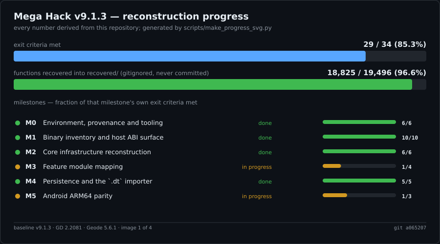
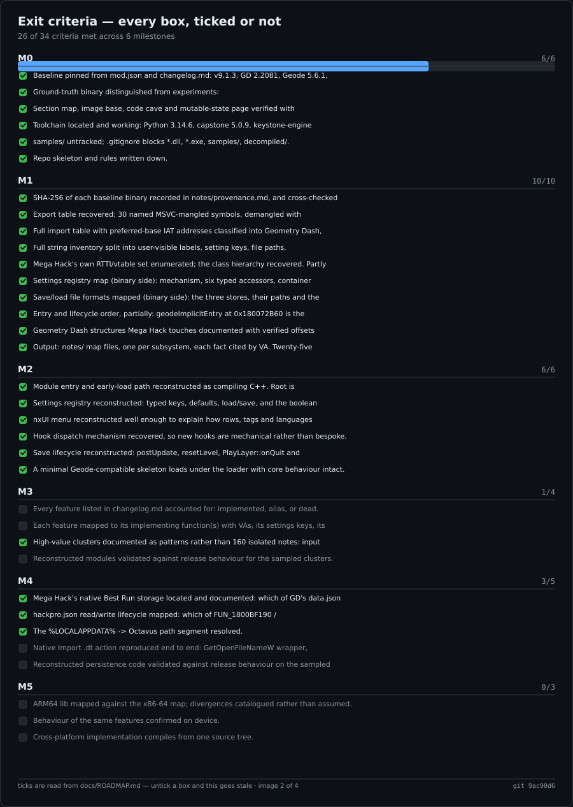
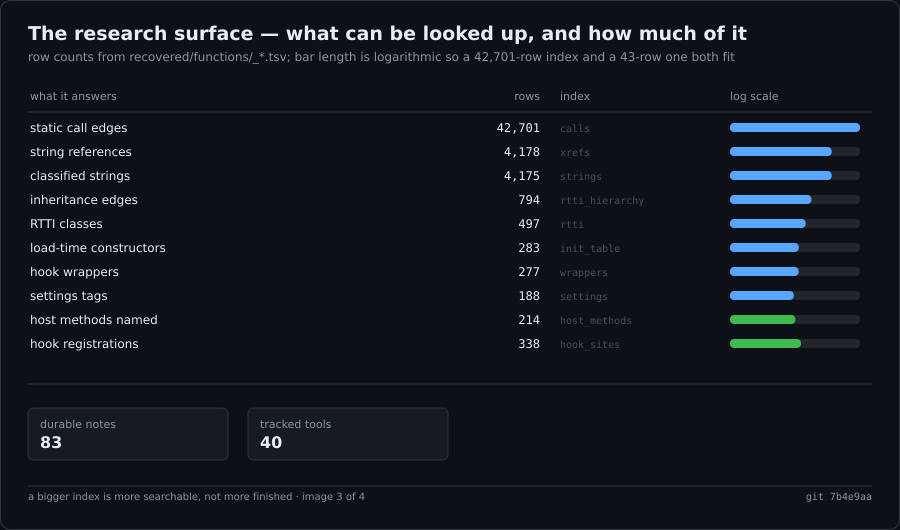
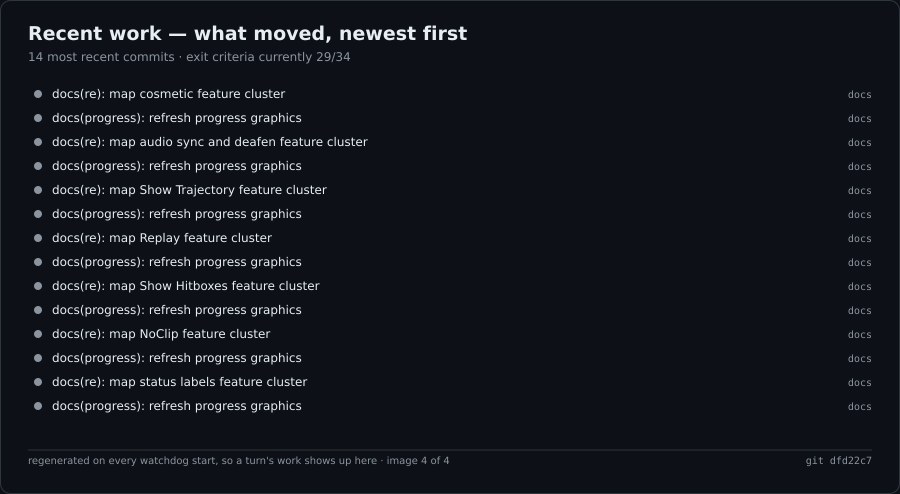

# megahack-research

Decompilation and reverse-engineering workspace for **Mega Hack** v9.1.3, the Geode mod
`absolllute.hackmega`.

The goal is a faithful, source-level reconstruction of the mod: recovered C++, documented
Geometry Dash host ABI, and reproducible tooling — **without** shipping, redistributing or
depending on Absolllute's proprietary binaries.

This repo holds research notes and original tooling only. See [docs/GOALS.md](docs/GOALS.md)
for what "done" means and [AGENTS.md](AGENTS.md) for the rules that keep the work honest.

## Progress

Four generated graphics, each a different lens on the same work, because one number cannot
portray progress honestly.









**What each one shows**

| Image | Shows |
| ----- | ------ |
| `progress.svg` | Overall exit-criteria fraction, decompilation, and each milestone's own fraction |
| `progress-criteria.svg` | **Every exit criterion, ticked or not** — the honest measure of M1–M5 |
| `progress-indexes.svg` | The searchable research surface: ten indexes by row count |
| `progress-activity.svg` | The 14 most recent commits, so a turn's work is visible at a glance |

All four are generated by `scripts/make_progress_svg.py` from `docs/ROADMAP.md`, the live
indexes, `recovered/decompile.log` and `git log` — not hand-drawn, so they cannot drift from
reality. They are regenerated on every `watchdog.ps1 -Action Start`, so arming the watchdog
is enough to refresh them.

`python scripts/make_progress_svg.py --check` fails if any is stale, and skips cleanly on a
fresh clone with no recovered tree. Two graphics are compared with the footer commit stamp
blanked, and `progress-activity.svg` is checked by subject against `git log` rather than by
bytes: every graphic stamps the HEAD it was built from, and the activity graphic shows the
most recent commits — so the newest of those is by definition the commit carrying the image.
Byte-comparing either against a fresh render would fail forever.

`scripts/test_progress_svg.py` re-renders all four and asserts that no text leaves the
canvas, that nothing overlaps on a shared baseline, and that every roadmap criterion gets
exactly one checkbox — the failure modes that XML validity alone does not catch.

Milestone status and exit criteria are tracked in [docs/ROADMAP.md](docs/ROADMAP.md); the
graphics above render the same data, so they cannot disagree with the tracker.

## Baseline

All work targets one pinned triple. Do not mix baselines.

| Component     | Version                        |
| ------------- | ------------------------------ |
| Mega Hack     | v9.1.3 (2026-04-17)            |
| Geometry Dash | 2.2081 (Windows + Android)     |
| Geode         | 5.6.1                          |
| Geode dep     | `geode.node-ids >= v1.22.0`    |

`mod.json` declares `"early-load": true`, so Mega Hack initialises before other mods and
relies on `node-ids` for stable hook addresses.

Target binaries and their roles are listed in [docs/GOALS.md](docs/GOALS.md#scope).

## PE layout (`_original.dll`)

Image base `0x180000000`. Verified with `tools/pe_caves.py`.

| Section  | VA             | Virtual size | File offset | Raw size   | Characteristics |
| -------- | -------------- | ------------ | ----------- | ---------- | --------------- |
| `.text`  | `0x180001000`  | `0x532fe6`   | `0x400`     | `0x533000` | `0x60000020`    |
| `.rdata` | `0x180534000`  | `0x1aaca4`   | `0x533400`  | `0x1aae00` | `0x40000040`    |
| `.data`  | `0x1806df000`  | `0x13cd90`   | `0x6de200`  | `0x121600` | `0xc0000040`    |
| `.pdata` | `0x18081c000`  | `0x39aec`    | `0x7ff800`  | `0x39c00`  | `0x40000040`    |
| `.tls`   | `0x180856000`  | `0x15`       | `0x839400`  | `0x200`    | `0xc0000040`    |
| `.rsrc`  | `0x180857000`  | `0x18c`      | `0x839600`  | `0x200`    | `0x40000040`    |
| `.reloc` | `0x180858000`  | `0xecbc`     | `0x839800`  | `0xee00`   | `0x42000040`    |

Two structural facts the patching work depends on:

- **Code cave** — a contiguous `0xCC` (INT3) region at VA `0x180286371`, file offset
  `0x285771`, size `0xc8f` (3215 bytes). All injected code lives here.
- **Mutable state** — 48 zero-initialised bytes at preferred VA `0x18081BFC0`, in the
  writable tail page of `.data`. Never place mutable state at an absolute address in
  `.text`; see the ASLR rule in [AGENTS.md](AGENTS.md).

## Layout

```
megahack-research/
├── AGENTS.md            # rules for humans and agents
├── docs/
│   ├── GOALS.md         # mission, scope, non-goals, definition of done
│   └── ROADMAP.md       # milestone tracker with exit criteria
├── notes/               # durable findings, one file per subsystem
├── references/          # reserved for external docs (see references/README.md)
├── samples/             # GITIGNORED — captured binaries and Absolllute's tooling
│   └── absolllute.hackmega/
│       ├── tools/       # pe_*.py, build/validate, ghidra_scripts/
│       └── .analysis_tools/  # vendored capstone, keystone, pefile, ordlookup
└── scripts/             # original tooling that outlives one investigation
```

`samples/` is deliberately untracked: it holds Absolllute's binaries, their shipped assets
and a vendored copy of their Python dependencies. Nothing in `docs/`, `notes/` or `scripts/`
may require a tracked file inside `samples/` to exist.

Consequence worth knowing: **the tooling in `samples/.../tools/` is not version-controlled
either.** A fresh clone has no analysis tooling until the sample set is restored. Promoting
the genuinely original parts into `scripts/` is tracked as open work in
[docs/ROADMAP.md](docs/ROADMAP.md#m1--binary-inventory-and-host-abi-surface-done).

## Recovered source

The mod is decompiled to readable pseudocode so it can be read, navigated and modified
locally.

```powershell
python scripts/decompile_all.py --keep-project --reuse-project
```

On the baseline with Ghidra 12.1.2 this yields **18,825 decompiled functions** in
`recovered/functions/` — one `.c` per function, each headed with its VA, RVA, signature,
size and caller count — plus `_index.tsv`, `_symbols.tsv` and a manifest. First run costs
~290 s of analysis; later runs reuse the project and take seconds.

> `recovered/` is **gitignored and must stay that way.** It is Absolllute's code as
> recovered by a decompiler. It is pseudocode for reading, not compilable source, and it is
> never committed. What is tracked is the recipe: `scripts/decompile_all.py` and
> `scripts/ghidra_scripts/ExportAllFunctions.java`.

Any finding gets promoted out of that tree into `notes/` as an address-and-tool-backed
claim; the raw dump does not get committed. Where the decompiler renders a short `std::string`
as a chain of typed locals, `scripts/decode_sso.py` rebuilds the text from the immediates;
`notes/sso-decoder.md` records that method and its three error modes.

Three results are worth knowing before repeating the search, because each looks like
an obvious shortcut:

- **The Android builds carry no RTTI.** Windows is MSVC with 517 type descriptors; both .so files
  are clang/Itanium with 3,052 _ZN method symbols and zero typeinfo. The 497-class inventory
  cannot be carried across, so M5 needs a different route — see [notes/android-abi.md](notes/android-abi.md).
- There is **no precomputed FNV-1a-64 table**. Mega Hack looks strings up in a chained
  FNV-1a-64 hash map (`FUN_18007CB60`: hash, mask, bucket, `memcmp`, chain walk), but the map
  is built during initialisation, so the 8-byte hashes of every recoverable string are absent
  from the image and a guessed key cannot be confirmed by finding its hash already stored.
  Verified with a positive control, and the hash itself against published FNV-1a-64 test
  vectors — see [notes/fnv-hash-probe.md](notes/fnv-hash-probe.md) and
  [notes/settings-registry.md](notes/settings-registry.md).
- Searching Ghidra's `DAT_` symbols alone finds only **4%** of code-referenced strings, because
  Ghidra names only the references it fails to decode.

## Tooling

### Tracked tools

These live in `scripts/`, so they exist on a fresh clone. Neither needs `samples/`.

| Tool                          | Purpose                                                                    |
| ----------------------------- | -------------------------------------------------------------------------- |
| `pe_rva.py`                   | Resolve an RVA or VA to a file offset, or explain why there isn't one        |
| `test_pe_rva.py`              | Regression tests for the above; skips itself when no sample set is present    |
| `decompile_all.py`            | Drive Ghidra headless and write the recovered pseudocode tree                |
| `ghidra_scripts/ExportAllFunctions.java` | Decompiles every function, one `.c` per function                   |
| `resolve_wrappers.py`         | Map Mega Hack's 277 runtime hook sites to their real targets                |
| `import_names.py`             | Name the import behind an `FF 25` thunk: 1,010 imports over 30 DLLs          |
| `test_import_names.py`        | Pin the import totals and the cocos2d names quoted in the notes               |
| `build_xref_index.py`         | Index every code-referenced string to the functions that name it            |
| `settings_index.py`           | Index the settings registry: 184 read tags over six typed accessors         |
| `build_callgraph.py`          | Build the call graph: 42,701 static edges over 16,204 functions              |
| `rtti_index.py`               | Walk MSVC RTTI: 497 polymorphic classes, each anchored to its vtable VA       |
| `decode_sso.py`               | Recover MSVC small-string literals the decompiler renders as typed locals    |
| `fnv_hash_probe.py`           | Hash recovered strings and look for a precomputed FNV-1a-64 table            |
| `test_demangle.py`            | Pin the RTTI demangler, including that it terminates rather than loops         |
| `make_progress_svg.py`        | Generate the four `docs/progress*.svg` graphics from live repo state         |
| `notify.ps1`                  | Send an indexed ntfy push; all notifications go through it                     |
| `watchdog.ps1`                | Liveness ping for long runs; refreshes the progress graphic on `-Action Start` |
| `run_supervised.ps1`          | Run a long command with stall detection; see `AGENTS.md`                     |
| `keepalive.ps1`             | Idle-detecting keep-alive that re-prompts the AI chat window                 |
| `compare_platform_classes.py` | Compare Windows/Android class sets across the two ABIs                  |
| `verify_platform_keys.py`     | Assert a Windows/Android key difference against both raw images             |
| `classify_strings.py`        | Split the string inventory into categories, each anchored to a VA            |
| `host_methods.py`            | Inventory the 214 GD host methods Mega Hack resolves by name at runtime      |
| `hook_sites.py`             | Enumerate every hook Mega Hack installs: method, host RVA and callback       |
| `tag_callback_map.py`         | Map all 125 tag registrations to their callbacks from instruction bytes      |
| `callback_hooks.py`           | Read each callback's hook targets, detours and installers off the bytes      |
| `lazy_stubs.py`               | List MH's lazily-bound host calls, with the host RVA behind each stub         |
| `check_inventory_evidence.py` | Fail if any label, registration or callback cited in the feature inventory disagrees with the binary |
| `init_table.py`              | Recover the CRT `_initterm` tables and the functions they call indirectly   |
| `test_init_table.py`         | Pin those tables and the zero-caller counts; skips without a sample set       |
| `test_settings_index.py`     | Pin the tag table and the argument splitter that has lost tags twice         |

`_strings.tsv` splits 4,175 code-referenced strings into 16 categories. The string-inventory
M1 criterion is now met: the Mega Hack-relevant categories (user-visible labels, setting
keys, file paths, language keys, format strings) are populated and VA-anchored, and the
region rule that separates Mega Hack's own strings from the statically linked library was
extended to every one of them — **415 rows** (230 user-label, 184 format-string, 1
file-path) moved to `third-party` when their referencing functions all live in the library
code region at or beyond `0x1803A4EE0`. The residual `other` bucket is down to **8.5%**
(353 rows) and is characterised rather than unknown: JSON keywords, CRT constants, version
strings and SSO decoder artefacts. The OpenSSL mass that
once polluted `mod-identifier` (974 of 980 rows) was reclassified to `third-party` by
code-region evidence (boundary `0x1803A4EE0`), so `mod-identifier` now holds only Mega
Hack's own identifiers (`icons_0`, `override_cols`, `player_ball`, ...). See
[notes/string-inventory.md](notes/string-inventory.md).

Those UI names and the numeric settings share **no** decompiled function, and that is now
explained rather than open: the join happens at the **exported API boundary**.
`hackpro::extensions::tagFor(std::string) -> std::optional<hackpro::Tag>` (`0x180072DF0`)
resolves a name to a 64-bit `Tag`, and every exported `getConfigVar<T>`/`setConfigVar<T>`
takes a `std::string` and calls it. A per-function string xref cannot see that join because
the names arrive as caller arguments, not literals.

The deeper consequence: **the registry itself is `hackpro.json`, not the binary.**
`FUN_18008B780` (VA `0x18008B780`) parses it with nlohmann/json, reading each member's JSON
key as the setting name and its `"tag"` number as the `Tag`, plus optional `"default"`,
`"action"` and `"nosave"` keys, and interns the pair via `FUN_18007C700`. Tag ↔ name is
maintained as a bijection in two runtime maps on `hackpro::BasicConfig`. So no static
analysis of `_original.dll` can enumerate the full key list — which is why the tags in
`_settings.tsv` are a sample of what code happens to read, not a count of what exists.

The registry is the **global object at VA `0x180800F58`**, at least `0x4A8` bytes, in
`.data`'s zero-fill tail — it has no bytes in the file at all and is built entirely by the
static constructor `FUN_1800A27E0`. Every accessor receives that global `+0xD8`. Its
constructor writes `hackpro::Config`'s primary vftable (`0x180544FD8`) at `registry + 0xD8`
and its secondary vftable (`0x180544FF0`, RTTI base offset 296 = `0x128`) at
`registry + 0x200`, which independently confirms the `Config`-at-`+0x128` layout that the
`add rcx, -0x128` thunk in `FUN_1800917B0` implies — two unrelated functions agreeing on
the same offset.

One trap worth stating, because this repo walked into it twice: **struct offsets are only
comparable once translated onto a common base.** The accessors' base is verified
(`registry + 0xD8`, so their `+0xB0` is `registry + 0x188`); the serialiser
`FUN_180076EB0` is `hackpro::BasicConfig::vtable[0]` and is called directly from
`FUN_18008A530` with `rcx` unmodified, so **its** base is UNVERIFIED. The earlier reading
— that the serialiser arrives at `+0x128` and therefore reads a *different* `+0xB0` field at
`object + 0x1D8` — is no longer asserted: if the two share a base they read the *same*
field, and the serialiser's circular walk (`mov rsi,[rdi+0xb0]`, then `r13 = *r13` until
`r13 == rsi`) is the map's own node list. Reading offsets without the base produced a false
"second registry" and a false "`+0xB0` is claimed twice"; both are recorded as failure
modes in [notes/settings-registry.md](notes/settings-registry.md).

`FUN_18002EE40` is the typed accessor for **`hackpro::Bytes`** — it logs that literal on a
miss — so all six accessors read the one registry, over five value types. It takes
the tag as its *third* argument, which is why an index that guessed argument position had
missed it entirely. That gap is now closed, and
`scripts/test_settings_index.py` pins it: the argument splitter is tested as a pure
function so it needs no sample set, and the specific tags (285, 501, `0x353`–`0x358`) are
pinned so a future accessor cannot go missing silently again. Both bug classes were
confirmed to fail the suite before the guards were trusted. See
[notes/settings-registry.md](notes/settings-registry.md).

```powershell
python scripts/pe_rva.py <image.dll> <rva-or-va> ... [--sections]
python scripts/test_pe_rva.py
python scripts/resolve_wrappers.py
python scripts/build_xref_index.py --grep best
python scripts/settings_index.py
python scripts/test_settings_index.py
python scripts/build_callgraph.py --callers-of 0x180169EB0
python scripts/rtti_index.py --hier
python scripts/decode_sso.py --grep KEYBINDS
python scripts/fnv_hash_probe.py --selftest
python scripts/classify_strings.py --category setting-key
python scripts/host_methods.py
python scripts/host_methods.py --grep resetLevel
python scripts/hook_sites.py
python scripts/hook_sites.py --method resetLevel
python scripts/import_names.py <image.dll> 0x180532410
python scripts/test_import_names.py
python scripts/init_table.py
python scripts/test_init_table.py
python scripts/make_progress_svg.py
python scripts/make_progress_svg.py --check
python scripts/make_progress_svg.py --only criteria
```

Finding code by feature name is the practical bottleneck, so ten indexes exist:

| Index | Rows | Answers |
| ----- | ---: | ------- |
| `_wrappers.tsv` | 277 | which function does this thunk actually call? |
| `_xrefs.tsv` | 4,178 | which functions name this string? |
| `_settings.tsv` | 188 | which tags are read, and by which accessor? |
| `_calls.tsv` / `_callers.tsv` | 42,701 | who calls what? |
| `_rtti.tsv` | 497 | which classes exist, and where is each vtable? |
| `_rtti_hierarchy.tsv` | 794 | what does each class derive from? |
| `_strings.tsv` | 4,175 | what kind of string is this, and where does it live? |
| `_init_table.tsv` | 283 | which functions run at load with **no** direct caller? |
| `_host_methods.tsv` | 214 | which GD methods does Mega Hack reach by name, and from where? |
| `_hook_sites.tsv` | 338 | which hooks does Mega Hack install, on which GD method, and at which target |

All ten live in `recovered/functions/` and are regenerated by the scripts above.

`_host_methods.tsv` exists because Mega Hack imports **zero** GD gameplay symbols, so there
is nothing in the import table to find. Those 214 method-name strings are the only handle on
the host ABI, and 350 functions across the tree reference them. Mega Hack's deepest coupling
is to the **level lifecycle**: `PlayLayer::resetLevel` alone is named by 25 functions,
`postUpdate` by 11 and `init` by 10 — 46 of 350 references between three methods. See
[notes/host-methods.md](notes/host-methods.md).

Having those strings is what made the call path recoverable. Mega Hack calls GD through
`GetModuleHandleA(NULL)` — `FUN_18010DDC0`, **278 direct callers**, the highest fan-out in the
binary — and treats hard-coded RVAs into that image as GD function addresses, wrapping each
in a Geode hook under a convention its debug types name `TulipConvention`:

| GD method | RVA into the host image |
| --------- | -----------------------: |
| `PlayLayer::resetLevel` | `0x3B8EB0` |
| `PlayLayer::levelComplete` | `0x3A7A80` |
| `GJGameLevel::savePercentage` | `0x16C8B0` |

Each is confirmed twice: the registration passes the RVA, and a lazy thunk independently
re-reads `GetModuleHandleA(NULL) + rva`. These are **absolute offsets into GD**, not
`node-ids`, so a re-baseline changes every one of them. See
[notes/hook-dispatch.md](notes/hook-dispatch.md).

`_hook_sites.tsv` then makes the whole intersection enumerable: **338 hook registrations over
215 distinct GD methods**, and every method maps to exactly one target (a hard-coded host RVA
for 317 of them, a name-resolved host symbol for the remaining 26 methods / 30 sites) with
none carrying two. `PlayLayer` alone accounts for 27 of those methods and 92 registrations,
`resetLevel` for 25 of them all landing on `0x3B8EB0`; the three RVAs confirmed above all
reproduce, which is the check that the positional pairing is sound. The hook surface is
broader than the level lifecycle: it spans rendering, input, audio, UI and editor paths too.

Two costs worth knowing about this index: 43 of the 338 callbacks are Ghidra `LAB_` labels
and 19 are data slots, neither with a recovered `.c`, and the `onQuit` hook body calls
`FUN_18002EE40`, the `hackpro::Bytes` accessor — which is why tag 285 was missing from
`_settings.tsv` until the index recorded argument position explicitly.

`_xrefs.tsv` (4,178) and `_strings.tsv` (4,175) differ by **three, and that is correct**: the
classifier drops rows whose text is whitespace only, and there are exactly three — two
VA-backed whitespace literals (`0x1805BDEE8`, `0x1805BEDA4`) and one SSO (`'   '`).
`_strings.tsv` has 4,174 distinct `(VA, text)` pairs out of 4,175 rows, so one pair is
listed twice; the two indexes are measuring the same thing rather than disagreeing.

These counts move when `decode_sso.py` improves. The 3,609 VA-anchored / 537 SSO split
became **3,609 VA-anchored / 566 SSO** when the decoder learned to read the stores Ghidra
casts — see [notes/sso-decoder.md](notes/sso-decoder.md). The VA-backed half did not move,
which is the check that the change only recovered stack-built literals and did not disturb
the image-resident inventory.

**`_init_table.tsv` exists because a call graph cannot see a pointer.** It is built from the
`_initterm`/`_initterm_e` imports, so it needs no hard-coded address. It contains **281 load-time
static constructors, 280 of which have zero direct callers** — they run on every DLL load and a
direct-call graph cannot show it. More broadly, 11,003 of the 18,825 functions have no direct
caller at all, so *absence of a caller is not evidence of dead code* anywhere in this repo.

One trap worth stating: `_callers.tsv` **omits** zero-caller functions rather than recording a
count of zero, so a missing row *means* zero. Reading it as "unknown" reports zero orphans and
hides the effect entirely. See [notes/init-table.md](notes/init-table.md).

`_rtti.tsv` comes from walking MSVC RTTI — TypeDescriptor, Complete Object Locator, then
the vtable that references it. It recovers Mega Hack's namespaces (`hackpro`, `core`,
`mega::extensions`, `mega::utils`, and `tabcore`, which is new) and shows
**nlohmann/json 3.12.0** statically linked into the binary. See
[notes/rtti-classes.md](notes/rtti-classes.md). It also recovers 794 distinct inheritance
edges — `numBases` sits at `+8` in the hierarchy descriptor, not `+0` as MSVC documents.

`_settings.tsv` is 184 distinct tag values read through six accessors — `FUN_18008F420`,
`FUN_18002DE50`, `FUN_180003D80`, `FUN_18002EE40`, `FUN_18002E4C0` and `FUN_18002D710` —
plus 4 keyed lookups through `FUN_18007CB60`. Those tags are
**64-bit `hackpro::Tag` values**, not small integers — the registry lives on
`hackpro::BasicConfig`, tag names exist only in a runtime map, and the exported
`hackpro::extensions::keyFor(Tag)` is the handle-to-name direction. The save file is keyed
by name, not by number. See [notes/settings-registry.md](notes/settings-registry.md).

On persistence, one correction is worth stating loudly rather than burying: **the
`best_runs.bin` sidecar documented in `samples/.../RE_NOTES_PERSISTENT_BEST_RUN.md` is not
Mega Hack's format.** A byte scan of all four Windows images finds `best_runs` and
`MHBRDB1` only in binaries this repo's patch generates; `_original.dll` contains neither,
and `_xrefs.tsv` gives them zero references. The release's own store is `hackpro.json`,
which is a flat name → typed-value map with no room for a per-level table. See
[notes/persistence.md](notes/persistence.md).

And the corollary, since it is surprising: **Mega Hack does not store Best Run data at
all.** The full hook surface was enumerated — 338 registration sites over 215 distinct GD
methods — and the only storage-side hook among them is `GJGameLevel::savePercentage`, which
can *veto* the call but never write one. Best Run is GD's own saved percentage; Mega
Hack's contribution is to stop a cheated run from being persisted. That is also why the
local patch needed a sidecar: there was no table to extend.

Note the gap between two numbers that are easy to conflate: Mega Hack **names** 214 host
methods but **hooks** only 12. Naming one is not hooking it. Five of those 214 are not host
methods at all — `hackpro::Bool`, `hackpro::Int`, `hackpro::Decimal`, `hackpro::String` and
`hackpro::Bytes` are Mega Hack's own **value types**, named through the same resolver. That
is how `FUN_18002EE40` was identified as `getConfigVar<hackpro::Bytes>`.

`build_xref_index.py` matches Ghidra's `DAT_` symbols, its inlined string literals, **and**
strings MSVC built in an SSO buffer: 3,609 of the rows are VA-backed, 566 are stack-built
and carry a `sso` marker with no VA, because those bytes only exist in a frame. Symbols
alone find only 4% of referenced strings, because Ghidra names only the references it fails
to decode.

`pe_rva.py` exists because converting an RVA to a file offset by linear subtraction is
wrong for any address past a section's `SizeOfRawData`, and the answer then looks
plausible while pointing into a different section. It distinguishes four cases — `backed`,
`zero-fill`, `gap`, `unmapped` — and refuses to read an address with no file backing. Both
wrong reads this project actually performed are pinned as tests, as is the third, which
indexed a file buffer with an RVA and silently produced plausible-looking output. See
[notes/provenance.md](notes/provenance.md#failure-modes-recorded).

For Ghidra scripts, compile with `javac` against the install's jars before running Ghidra:
Ghidra reports a script compile error as a `ClassNotFoundException`, which sends you looking
for a classloader problem that does not exist. Details in
[notes/new-best-label.md](notes/new-best-label.md#ghidra-12-headless-traps).

### Sample tooling

Everything under `samples/` is untracked, so these only exist once the sample set is
restored.

`python` is not on `PATH` on this machine (the WindowsApps entries are Store stubs). Use:

```powershell
$py = "C:\Users\Robert_\AppData\Local\Python\bin\python3.exe"   # 3.14.6
```

A second interpreter exists for the bundled GUI launcher:
`%USERPROFILE%\.cache\codex-runtimes\codex-primary-runtime\dependencies\python\python.exe`
(3.12.14). Use the 3.14 one for analysis; both satisfy the tooling.

Every tool in `samples/absolllute.hackmega/tools/` does
`sys.path.insert(0, ".analysis_tools")`, so **run them from the mod root**
(`samples/absolllute.hackmega/`, the directory that holds `.analysis_tools/`):

```powershell
Set-Location samples/absolllute.hackmega
& $py .\tools\pe_caves.py .\absolllute.hackmega_original.dll
```

| Tool                         | Purpose                                                     |
| ---------------------------- | ----------------------------------------------------------- |
| `pe_exports.py`              | Named exports and preferred-base VAs                         |
| `pe_imports.py`              | Imports and IAT addresses                                    |
| `pe_disasm.py`               | Disassemble at VA/RVA; `--callers` finds direct call sites    |
| `pe_xrefs.py`                | Locate strings (ASCII/UTF-16) and code references to them     |
| `pe_caves.py`                | Sections plus uniform-byte caves in executable sections       |
| `build_persistence_patch.py` | Regenerates the extended persistence binary (idempotent)     |
| `validate_persistence_patch.py` | Static validator: hooks, cave, ABI, ASLR, imports, state   |
| `best_runs_db.py`            | Inspect/export/import/repair/compact the best-runs database  |
| `test_best_runs_db.py`       | 12 DB/import regression tests                                 |
| `update_geode_package.py`    | Persist a patched DLL back into the installed `.geode` archive |

### Ghidra

Ghidra 12.1.2 at `C:\Users\Robert_\Downloads\ghidra_12.1.2_PUBLIC_20260605`. Headless
scripts live in `samples/absolllute.hackmega/tools/ghidra_scripts/` under category
`HackMega`:

- `DumpDecompile.java <address>...` — decompile the functions containing each address
- `DumpDecompileFile.java <out> <address>...` — same, written to a report file
- `FindAsciiReferences.java <out> <text>...` — strings, their references and their callers

An IDA database of the same binary also exists outside this repo at
`C:\Users\Robert_\Documents\decomp\mh` (`mh.gpr`, `mh.rep`). Treat it as a private cache;
findings belong in `notes/`.

## Workflow

1. **Pin the question.** One investigation, one written question, recorded in `notes/`.
2. **Locate.** `pe_xrefs.py` for strings, `FindAsciiReferences.java` in Ghidra,
   `pe_exports.py` / `pe_imports.py` for the host ABI surface.
3. **Disassemble.** `pe_disasm.py` for raw truth, Ghidra for structure.
4. **Prove.** Re-derive the address from a second independent angle before writing it down.
5. **Record.** Evidence with file, VA, RVA and the tool that produced it.
6. **Only then** propose code. Anything derived goes in `scripts/`, and any binary a script
   emits must be reproducible from that script alone.

Before pushing anything that touches geometry or state (run from
`samples/absolllute.hackmega/`, where `.analysis_tools/` lives):

```powershell
& $py .\tools\validate_persistence_patch.py
& $py .\tools\test_best_runs_db.py
```

## Known geometry — two different kinds of claim

These addresses all resolve to real instructions in `_original.dll`, checked with
`pe_disasm.py`; none is in the INT3 cave. But they are **not all the same kind of claim**,
and collapsing them into one "verified" table is how a patch site gets quoted as release
behaviour.

**Mega Hack's own code, role confirmed:**

| Address        | Role                                                            |
| -------------- | --------------------------------------------------------------- |
| `0x1800023DC`  | Resolves the native import action tag after core load           |
| `0x180027C30`  | Dispatches that tag to the `.dt` importer                       |
| `0x180098868`  | Substitutes `STATUS/*/PREFIX` with `Import .dt` per language    |
| `0x180174DE4`  | Exit/save call reached from `PlayLayer::onQuit`                 |

**Patch hook sites whose labels are now corroborated by the release.** Mega Hack resolves
the matching GD method by name in the function immediately preceding this hook region —
`FUN_1801551F0` (VA `0x1801551F0`, 213 bytes, one caller) names `PlayLayer::resetLevel`,
`PlayLayer::postUpdate` and `PlayLayer::init`:

| Address        | Label                          | Corroborated by                    |
| -------------- | ------------------------------ | ---------------------------------- |
| `0x1801552D6`  | Original init call             | `FUN_1801551F0` names `PlayLayer::init` |
| `0x180155408`  | Reset / save wrapper           | `FUN_1801551F0` names `PlayLayer::resetLevel` |
| `0x18015546B`  | Post-update tracking wrapper   | `FUN_1801551F0` names `PlayLayer::postUpdate` |

**Patch hook sites still carrying only the patch's own labels:**

| Address        | Label as used by the patch                                       |
| -------------- | --------------------------------------------------------------- |
| `0x180155155`  | Shutdown / destructor wrapper                                   |
| `0x1801553EC`  | Restore matching records, reproduce original epilogue           |
| `0x180155419`  | Canonicalises StartPos percentage before Mega Hack stores it     |

`0x180155419` is the one that most looks like an independent fact and is not: the release
binary has `movsd qword ptr [rip + 0x6b6b27], xmm0` followed by `add rsp, 0x20; pop rsi` —
a double stored to a global, then a return. That is consistent with storing a percentage,
but "canonicalises StartPos percentage" is a reading, not a derivation.

Derivation and the full host-method inventory: [notes/host-methods.md](notes/host-methods.md).

Patch details — level-identity scheme, database format, hook map — live in
`samples/absolllute.hackmega/RE_NOTES_PERSISTENT_BEST_RUN.md`. **That note describes the
local patch, not the release**; see [notes/persistence.md](notes/persistence.md) for the
byte-scan evidence.

## Disclaimer

This project is for interoperability, research, preservation and compatibility. It does not
include, distribute or require copyrighted software, firmware, keys or proprietary
libraries. Mega Hack is the work of Absolllute; Geometry Dash is the work of RobTop Games.
Anyone using binaries here is responsible for holding the relevant rights and complying
with applicable law and licence terms.

## License

Original tooling and notes in this repository are licensed under the
[GNU General Public License v3](LICENSE). Mega Hack, Geometry Dash and Geode are the
property of their respective authors and are not relicensed by this repository.